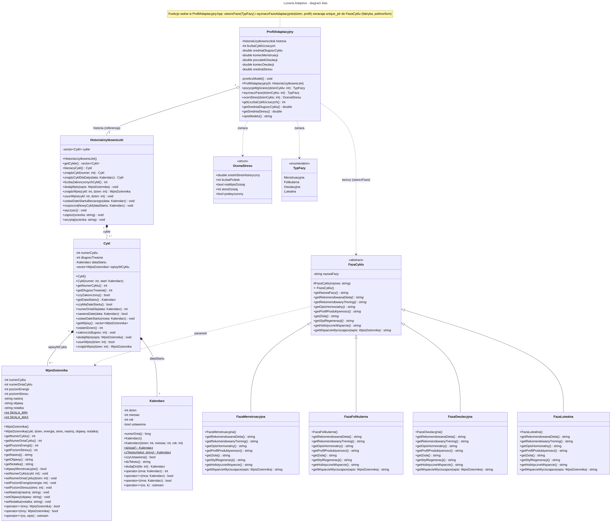

# LunariaAdaptive
Konsolowy, adaptacyjny system analizy cyklu biologicznego i rekomendacji w C++  
## O projekcie  
Wiele popularnych narzędzi ślepo zakłada uniwersalny, sztywny model cyklu, sprowadzając biologię do prostej matematyki kalendarzowej i całkowicie ignorując unikalność fizjologii każdego człowieka.
`LunariaAdaptive` **dopasowuje się do historii konkretnej użytkowniczki**, a rekomendacje opiera na fazie cyklu wyznaczonej z jej własnych danych.
* **Adaptacyjność:** System oblicza parametry na podstawie realnie wprowadzanych danych. Im więcej cykli użytkownik wprowadzi do bazy, tym precyzyjniej program estymuje długość nadchodzących faz.  
* **Polimorficzny system rekomendacji:** Każda faza biologiczna oparta na profilu hormonalnym jest osobną klasą. Dzięki temu program w sposób dynamiczny generuje dedykowane wskazówki.
* **Automatyczne liczenie dnia cyklu.** Podajesz tylko datę początku cyklu,
  resztę program liczy sam.
* **Korekta stresowa:** jeśli stres z dzisiejszego wpisu wyraźnie przekracza Twoją historyczną normę dla tego okresu cyklu, rekomendacja zostaje uzupełniona o wsparcie wyciszające.

> Lunaria to inspiracja wellness, nie porada medyczna. W razie ciąży, chorób lub przyjmowania leków skonsultuj zioła i zmiany diety z lekarzem lub farmaceutą.

## Funkcje

- Dziennik: energia, stres, objawy, nastrój i notatka dla każdego dnia
- Dodawanie, wyszukiwanie, edycja i usuwanie wpisów
- Rekomendacje na dziś lub dowolną datę (także prognoza)
- Podgląd tego, czego nauczył się program
- Tryb demo z przykładowymi danymi, żeby szybko wypróbować program
- Automatyczny zapis i odczyt danych z pliku, z ochroną przed uszkodzonym zapisem

## Kompilacja i uruchomienie

Wymagania: kompilator obsługujący **C++17** (np. `g++` / MinGW-w64 / MSYS2, Clang lub MSVC).

Pobierz repozytorium i przejdź do folderu projektu:

```bash
git clone https://github.com/mag-sud/LunariaAdaptive.gitcd LunariaAdaptive
cd LunariaAdaptive
```

### Windows (PowerShell / MSYS2 / MinGW)

Kompilacja:

```powershell
g++ -std=c++17 -Wall -Wextra -Wpedantic -Isrc src/*.cpp -o lunaria.exe
```

Uruchomienie:

```powershell
.\lunaria.exe
```

### Linux / macOS

Kompilacja:

```bash
g++ -std=c++17 -Wall -Wextra -Wpedantic -Isrc src/*.cpp -o lunaria
```

Uruchomienie:

```bash
./lunaria
```

## Pierwsze kroki

- Przy pierwszym uruchomieniu (gdy nie ma jeszcze pliku `lunaria_dane.txt`) program poprosi o podanie daty początku bieżącego cyklu w formacie **`DD-MM-RRRR`**.
- W menu głównym możesz wybrać opcję **`9`**, aby wczytać dane demonstracyjne i od razu przetestować działanie modelu adaptacyjnego, wpisów z dziennika oraz rekomendacji.
  - Twoje dane zapisują się lokalnie w pliku `lunaria_dane.txt`. Aplikacja nie łączy się z Internetem i niczego nie wysyła.

> Na Windowsie program korzysta z kodowania UTF-8 w konsoli (polskie znaki i emoji), dlatego najlepiej uruchamiać go w **Windows Terminal** lub **PowerShellu**.

## Profil adaptacyjny

Klasa `ProfilAdaptacyjny` przelicza model z historii przy każdym użyciu:
1. **Długość cyklu:** średnia z zakończonych cykli. Cykle nietypowe (krótsze niż 10 dni, a przy co najmniej dwóch typowych cyklach także poniżej 0,5 lub powyżej 1,6 dotychczasowej średniej) są pomijane. Tylko bez historii cykli przyjmowane jest domyślnie 28 dni.
2. Koniec menstruacji: ok. 14% średniej długości cyklu (minimum 1 dzień).
3. Okno owulacji: jeśli w historii są dni szczytu (najwyższa różnica energia − stres), okno to średni dzień szczytu ±1. W przeciwnym razie szacunek startowy: 45–62% długości cyklu.
4. Faza dla danego dnia: dzień w granicach menstruacji → faza menstruacyjna; przed oknem owulacji → folikularna; w oknie → owulacyjna; po nim → lutealna. Skurcze, krwawienie w pierwszej połowie cyklu wymuszają fazę menstruacyjną.
5. Korekta stresowa: stres z dzisiejszego wpisu jest porównywany ze średnim stresem z historii w okolicach tego samego dnia cyklu (±1 dzień, bez dzisiejszego wpisu). Różnica o co najmniej 1 punkt oznacza stres podwyższony.

## Klasy i relacje

| Klasa | Rola |
| --- | --- |
| `Kalendarz` | data z walidacją, różnica dat w dniach, dodawanie dni, parsowanie i zapis `DD-MM-RRRR` |
| `WpisDziennika` | jeden dzień w dzienniku (energia i stres w skali 1–5, objawy, nastrój, notatka) |
| `Cykl` | pojedynczy cykl: numer, data startu, długość, lista wpisów |
| `HistoriaUzytkowniczki` | wszystkie cykle, operacje na wpisach i cyklach, zapis i odczyt pliku |
| `ProfilAdaptacyjny` | model uczący się z historii, wyznaczanie fazy i oceny stresu |
| `FazaCyklu` | abstrakcyjna klasa bazowa (interfejs rekomendacji) |
| `FazaMenstruacyjna`, `FazaFolikularna`, `FazaOwulacyjna`, `FazaLutealna` | klasy pochodne z konkretnymi rekomendacjami |

## Zastosowane mechanizmy programowania obiektowego

| Mechanizm | Gdzie i jak |
| --- | --- |
| Enkapsulacja | pola `private`, gettery i settery; settery `WpisDziennika` walidują skalę 1–5 |
| Konstruktory domyślne i parametryczne | `Kalendarz`, `WpisDziennika`, `Cykl`; `explicit` przy konstruktorach jednoargumentowych |
| Operacje na obiektach | dodawanie, wyszukiwanie, edycja i usuwanie wpisów (menu 1, 5, 6); `Cykl::dodajWpis`, `znajdzWpis`, `usunWpis` |
| Dziedziczenie i konstruktory pochodnych | klasy faz wywołują chroniony konstruktor `FazaCyklu(nazwa)` na liście inicjalizacyjnej |
| Metody wirtualne i `override` | 8 metod czysto wirtualnych w `FazaCyklu` (m.in. `getRekomendowanaDieta`, `getWsparcieWyciszajace`), przesłonięte w każdej fazie; `getNazwaFazy` to zwykła metoda wirtualna z implementacją w bazie |
| Polimorfizm | `pokazRekomendacje` w `main.cpp` wywołuje metody przez `unique_ptr<FazaCyklu>`, nie znając konkretnej fazy |
| Metody `const` | gettery, operatory porównań, wszystkie metody `FazaCyklu` |
| Przeciążanie operatorów | `Kalendarz`: `-`, `==`, `<`, `<<`; `WpisDziennika`: `==`, `<`, `<<` (użycie: `std::find` i `std::sort` w `Cykl::dodajWpis`, `data - dataStartu` w `Cykl::numerDniaDla`, `cout << wpis` w wypisywaniu historii) |
| Wyjątki | `invalid_argument` (walidacja danych), `out_of_range` (brak cyklu lub wpisu), `runtime_error` (błędy pliku), `ios_base::failure` (koniec wejścia); obsługa w pętli menu w `main` |

## Przykład działania

Poniżej znajduje się fragment sesji po wczytaniu danych demo (opcja 9), dodaniu wpisu na dziś ze stresem 5/5 (opcja 1) i wyświetleniu rekomendacji (opcja 2). Daty zależą od dnia uruchomienia, a długie opisy skrócono.

```text
Dziś: 22-11-2026 | cykl 4, dzień 13

===== 22-11-2026 | dzień cyklu: 13 =====
🌒 Faza Folikularna | Księżyc Przybywający (narodziny energii)

Hormony:         Stopniowy wzrost poziomu estrogenów. Poprawa nastroju [...]
Dieta:           Lżejsze, świeże posiłki bogate w białko, kiełki [...]
Trening:         Wzrost siły i energii! Doskonały moment na intensywniejszy trening [...]
[...]

--- Korekta adaptacyjna: wsparcie wyciszające ---
W Twojej historii w okolicach tego dnia cyklu stres wynosi średnio 2.0/5 (Twoja norma: 2.5/5, 10 pomiarów).
Dzisiejszy wpis pokazuje stres na poziomie 5/5.

Wsparcie na dziś: Mimo że trwa faza folikularna, Twój dzisiejszy stres lub zmęczenie
są wysokie. Odpuść ambitne zadania, zrób przerwę od ekranu i postaw na głęboki oddech.
```

Opcja 3 (profil modelu) dla tych samych danych:

```text
Zakończone cykle w modelu: 3
Średnia długość cyklu: 32.7 dni
Koniec menstruacji: ok. dnia 5
Okno owulacji: dni 17-19
Średni poziom stresu: 2.5
```

Walidacja danych, np. błędna data:

```text
Data wpisu (Enter = dziś): 30-02-2026
Nieprawidłowa data (oczekiwany format DD-MM-RRRR)
```

## Format pliku zapisu

Plik `lunaria_dane.txt` jest tekstowy, pola rozdzielone tabulatorami: wiersz `C` opisuje cykl (numer, długość, data startu), a kolejne wiersze `W` należą do niego (cykl, dzień, energia, stres, nastrój, objawy, notatka). Jeśli plik jest uszkodzony, program nie nadpisuje go, tylko zmienia nazwę na `lunaria_dane.txt.uszkodzony` i zaczyna od pustej historii.

## Struktura projektu

```text
.
├── README.md
├── lunaria_uml.svg                diagram klas UML
└── src/
    ├── main.cpp                   interfejs konsolowy i menu
    ├── FazaCyklu.*                abstrakcyjna klasa bazowa faz
    ├── FazaMenstruacyjna.*        ┐
    ├── FazaFolikularna.*          │ klasy pochodne (polimorfizm)
    ├── FazaOwulacyjna.*           │
    ├── FazaLutealna.*             ┘
    ├── ProfilAdaptacyjny.*        profil użytkowniczki uczący się z jej historii
    ├── HistoriaUzytkowniczki.*    wszystkie cykle, zapis i odczyt
    ├── Cykl.*                     pojedynczy cykl i jego wpisy
    ├── WpisDziennika.*            jeden dzień w dzienniku
    └── Kalendarz.*                daty i liczenie dnia cyklu
```

### Diagram klas UML

## Uwagi

Część logiki kalendarzowej w `Kalendarz.cpp` (przeliczanie daty na liczbę dni i z powrotem) bazuje na algorytmach Howarda Hinnanta, udostępnionych na licencji MIT. Informacja o prawach autorskich znajduje się w komentarzu w kodzie.
